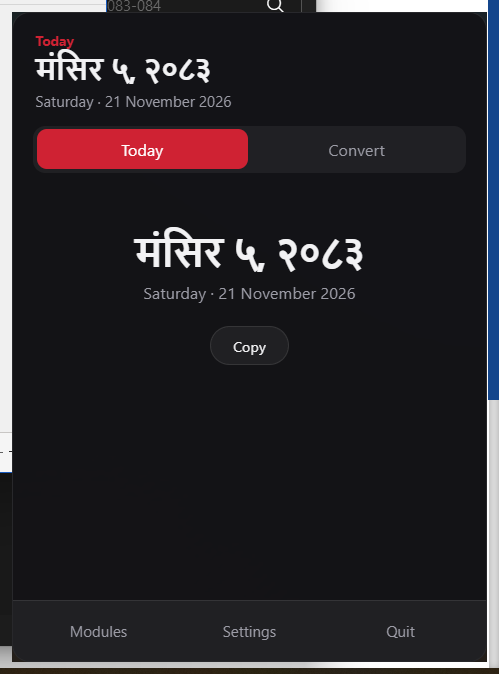
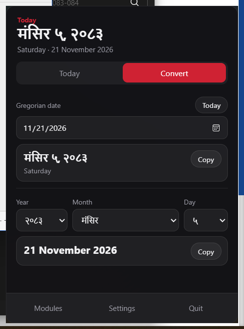
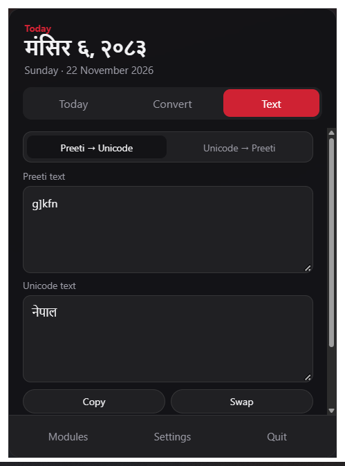
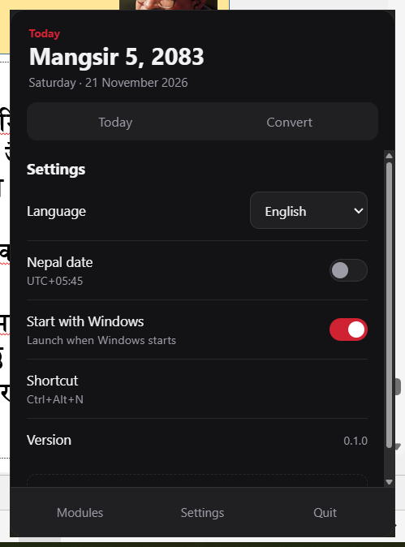

<p align="center">
  
</p>

# NepaliToolkit, a Nepali date and Bikram Sambat tray app for Windows


NepaliToolkit keeps today's Nepali date in the Windows notification area and
converts dates between Bikram Sambat (BS) and the Gregorian calendar in both
directions. It is built in Rust with Tauri 2 and the system webview, and it runs
offline. The only network request is the update check you start yourself. It does
not use Electron or Node, and it does not bundle a browser.

<p align="center">
  
</p>

## What it does

The tray icon shows the BS day in Devanagari digits. Hovering it shows the full
date, for example `मंसिर ५, २०८३ - Saturday`. A left click or `Ctrl+Alt+N` opens
the panel, which always shows today's full BS date, the weekday and the AD
equivalent.

The app ships three modules:

- Today shows the date and a copy button.
- Converter translates a Gregorian date to BS and a BS date to Gregorian, live in
  both directions.
- Text converts Nepali text between the legacy Preeti encoding and Unicode
  Devanagari, live in both directions.

The Modules page turns any module off. Settings holds the interface language
(English by default, Nepali available), a switch that uses Nepal time
(UTC+05:45) instead of the machine's date, the autostart toggle, and the update
channel with a Check for updates button.

### Text, Preeti and Unicode

Preeti is a legacy Nepali font that stores Devanagari on ordinary Latin keys, so
text typed in it reads `g]kfn` anywhere the font is missing. The Text module
converts that encoding to Unicode and back: type or paste in either box and the
other follows. Characters Preeti cannot write are left as they are and listed
under the box instead of being guessed.

`Ctrl+Alt+P` converts the selection in any other application in place: the app
copies it, converts it, pastes it back and restores your clipboard. In auto mode
the direction follows the script of the selection. The Text module can switch to
two explicit shortcuts instead, `Ctrl+Alt+P` for Unicode to Preeti and
`Ctrl+Alt+U` for the reverse. The shortcut does not run inside the panel, and it
only preserves the text part of the clipboard.

The Nepali date always renders in Nepali, with Devanagari digits and Nepali month
names, in both interface languages. The weekday and the Gregorian date follow the
interface language.

The app starts with Windows by default, runs as a single instance, and stores no
telemetry. It checks for updates only when you press the button in Settings, and
follows the stable, beta or alpha channel you pick.

## Screenshots

<p align="center">
  
  
  
</p>

<p align="center"><em>Convert, Text and Settings. The tray tooltip shows the full date, for example मंसिर ५, २०८३ - Saturday.</em></p>

## What Bikram Sambat is

Bikram Sambat (BS, विक्रम संवत्) is Nepal's official civil calendar and the basis
of the Nepali patro. It runs about 56 years and 8 months ahead of the Gregorian
calendar.

BS month lengths do not follow a formula. They are published in a table that
changes from year to year, so the accuracy of a Nepali date app depends on the
table it ships as much as on its code. NepaliToolkit supports BS 1975 to 2100,
which is 1918-04-13 to 2044-04-13 in the Gregorian calendar. Years after 2090
have no published gazette yet, and the interface marks them as projected.

Preeti conversion is checked against a corpus of 127 pairs in
`data/preeti-corpus.tsv`. Each pair was checked against an independent
MIT-licensed converter where that converter covers the case; rows marked as
extensions are explained in the file. `cargo test` replays each one in both
directions. The key table is factual layout data; its source and hash are in
`data/SOURCES.md`.

## Install

The 0.1.10 alpha ships as a per-user installer and a portable zip for Windows 10
and 11, 64-bit.

- [Installer](https://github.com/NepaliTools/NepaliTools/releases/download/v0.1.10-alpha/NepaliToolkit-0.1.10-alpha-win64-setup.exe)
  installs for the current user, adds a Start Menu shortcut and an uninstaller,
  and needs no administrator.
- [Portable zip](https://github.com/NepaliTools/NepaliTools/releases/download/v0.1.10-alpha/NepaliToolkit-0.1.10-alpha-win64-portable.zip)
  extracts and runs from any folder.
- [Release notes and checksums](https://github.com/NepaliTools/NepaliTools/releases/tag/v0.1.10-alpha)
  cover both.
- The build is unsigned, so Windows may show "Windows protected your PC". Choose
  More info, then Run anyway.

Both need the WebView2 runtime. Windows 11 includes it; some Windows 10 machines
need the
[Evergreen runtime](https://developer.microsoft.com/microsoft-edge/webview2/).
The installer embeds the bootstrapper.

0.1.10 adds the Text module and the in-place shortcut. Install it once; from then
on Settings has Check for updates. Open Settings, pick Stable, Beta or Alpha, then
press Check: the app reads that channel's signed manifest from
nepalitools.pages.dev, downloads the signed installer from GitHub Releases if a
newer build exists, installs it quietly and restarts. There is no background
check. The portable build tells you to download the new zip instead of replacing
itself.

Every release is published to alpha first. Moving one to beta or stable is a
manifest change, not a rebuild, so stable never receives bytes that did not first
ship on alpha. Alpha is the only channel with a release today.

The app starts in the notification area. Windows 11 usually places new tray icons
in the hidden-icons overflow behind `^`. Drag the icon onto the taskbar to pin it.
Autostart is on by default and can be turned off in Settings.

To remove the installed copy, open Settings, Apps, Installed apps, find
NepaliToolkit and choose Uninstall, or run
`%LOCALAPPDATA%\NepaliToolkit\uninstall.exe`. For the portable copy, turn
autostart off, quit, then delete the folder. Settings and the log live in
`%APPDATA%\com.aaxyat.nepalitoolkit\`.

## Build from source

You need Rust with the MSVC toolchain
(`rustup default stable-x86_64-pc-windows-msvc`). No Node.js or npm is involved.

```powershell
git clone https://github.com/NepaliTools/NepaliTools.git
cd NepaliTools
cargo test --workspace
cargo build --release -p nepalitoolkit
```

The app embeds the date table at compile time with `include_str!`. The UI in
`crates/host/ui` is plain HTML, CSS and JavaScript, so there is no frontend build
step.

## Data and accuracy

The fetch script assembles `data/bs-months.csv` from four separate Bikram Sambat
tables. A strict majority decides each month length. The script writes ties and
single-source years to `data/overrides.csv` with the competing values and a note.
`data/SOURCES.md` lists each source, its version, URL, retrieval date and SHA256.

The test suite converts every day in both directions, 46,022 days each way. It
checks monotonicity and external anchors, and it fails if a source disagreement
is not recorded in the overrides file.

To refresh the snapshot, the data side's only network step:

```powershell
powershell -ExecutionPolicy Bypass -File tools\fetch-bs-data.ps1
```

## Privacy

The app collects no telemetry. It makes no network request until you press Check
for updates in Settings; that request fetches a version manifest and, if you
choose to install, the signed installer from GitHub Releases. Nothing about you is
sent. Settings live in `%APPDATA%\com.aaxyat.nepalitoolkit\settings.json`. A
diagnostic log sits next to it and never leaves the machine.

## FAQ

### How do I show the Nepali date in the Windows taskbar?

Run NepaliToolkit and pin its tray icon. The icon shows the BS day in Devanagari,
and the tooltip carries the full date.

### Can it convert BS to AD and AD to BS without internet?

Yes. Both directions use the bundled table. Conversion makes no network calls.

### How do updates work?
Open Settings, choose a channel, then press Check for updates. The app fetches
that channel's signed manifest, and if a newer build exists it downloads the
signed installer, verifies the signature and installs it quietly. The app
restarts when the install finishes. There is no background check and no automatic
download. The portable build points you at the release page instead, because it
cannot replace itself.

### What is the difference between Stable, Beta and Alpha?

Alpha gets every build. Beta and stable receive the same signed installer later,
when it has been promoted, so they always lag alpha by at least one release.
Channels share one version line: a build promoted to stable keeps its version
number. New installs start on alpha because every published build is an alpha.

### How do I convert Preeti text to Unicode?

Open the Text tab, keep Preeti to Unicode selected, paste the text and copy the
result. It also works the other way, and it runs offline. To convert a selection
in another app, press `Ctrl+Alt+P`.

### Does the shortcut change my clipboard?

It saves the clipboard text, copies your selection, converts it, pastes it back
and restores what was there. Rich content on the clipboard, such as an image, is
not preserved; only text is.

### Why does the shortcut say it cannot run in the panel?

Injecting keys into the panel's own webview would paste into the converter box,
so the shortcut refuses there. Use the Text tab instead.

### Which years are supported?

BS 1975 to 2100, or 1918-04-13 to 2044-04-13 AD. Results after 2090 are labelled
projected because no gazette exists for those years yet.

### Why does the icon show the day and not the month?

A day number stays readable at 16 px, and a month name does not. The tooltip and
the panel carry the full date. Each day from 1 to 32 is drawn at 16, 20, 24 and
32 pixels, so two Devanagari digits stay legible, and the app picks the size that
matches your display scale.

### Is there a macOS version?

Not yet. The host is Tauri 2 and the date core does not depend on the platform.
macOS is the next milestone.

### Does it need Node.js, npm, or Electron?

No. The app uses Rust and the system webview, and the panel is plain HTML, CSS and
JavaScript.

## Project layout

```
crates/core/       npt-core: BS conversion, formatting, no dependencies
crates/host/       Tauri 2 app: tray, panel, commands, settings
crates/host/ui/    plain HTML/CSS/JS panel, no build step
data/              bs-months.csv, sources/, overrides.csv, SOURCES.md
tools/             data fetch, icon and badge generation, capture helpers
docs/adr/          architecture decisions
docs/evidence/     acceptance screenshots
wiki/              wiki source pages
```

More reading: [GLOSSARY](GLOSSARY.md), [ACCEPTANCE](ACCEPTANCE.md),
[architecture decisions](docs/adr/), [brand](assets/brand/BRAND.md),
[changelog](CHANGELOG.md), [contributing](CONTRIBUTING.md).

## Status

0.1.10 alpha. Windows only, unsigned, and used daily by its author. The project is
not affiliated with the Government of Nepal or any calendar authority.

## License

MIT, see [LICENSE](LICENSE). The bundled month-length data comes from MIT
licensed projects listed in [data/SOURCES.md](data/SOURCES.md).
