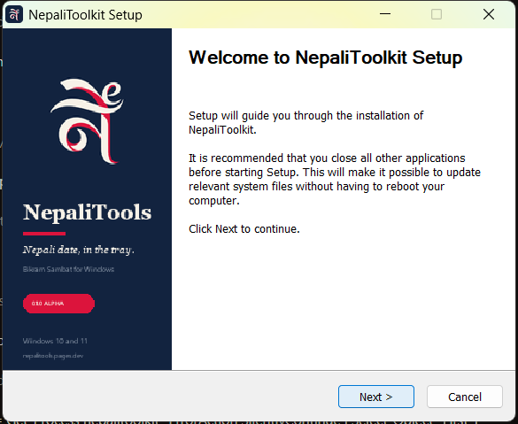

# NepaliToolkit 0.1.0 alpha

The first alpha build for Windows 10 and 11, 64-bit. It is unsigned.



## Download

- [Installer](https://github.com/NepaliTools/NepaliTools/releases/download/v0.1.0-alpha/NepaliToolkit-0.1.0-alpha-win64-setup.exe).
  Per-user, no administrator. Adds a Start Menu shortcut and an uninstaller.
- [Portable zip](https://github.com/NepaliTools/NepaliTools/releases/download/v0.1.0-alpha/NepaliToolkit-0.1.0-alpha-win64-portable.zip).
  Extract and run `NepaliToolkit.exe`.
- [SHA256SUMS](https://github.com/NepaliTools/NepaliTools/releases/download/v0.1.0-alpha/SHA256SUMS.txt).

Both need WebView2. Windows 11 includes it. The installer embeds the WebView2
bootstrapper for older Windows 10 machines.

The build is unsigned, so Windows may show "Windows protected your PC". Choose
More info, then Run anyway.

## What is inside

- Today: the Bikram Sambat date in the notification area, a Devanagari day badge
  redrawn at midnight, and a full-date tooltip.
- Converter: BS to AD and AD to BS from 1975 to 2100, live as you type, with
  explicit out-of-range errors and projected markers after 2090.
- Modules: turn Today or Converter off without uninstalling anything.
- Settings: English or Nepali interface, Nepal time instead of the machine date,
  and start with Windows.
- Offline: the date table ships inside the binary. No network calls, no telemetry
  and no accounts.
- Data: four published tables, a documented majority rule, 27 disputed months and
  120 single-source months in `data/overrides.csv`.
- A single instance, `Ctrl+Alt+N`, and a compact 380 by 520 panel.

The Nepali date always renders in Nepali, with Devanagari digits and Nepali month
names, in both interface languages. The weekday and the Gregorian date follow the
interface language.

## Install

1. Run `NepaliToolkit-0.1.0-alpha-win64-setup.exe`.
2. Choose the install folder. The default is `%LOCALAPPDATA%\NepaliToolkit`.
3. Finish. The app opens from the Start Menu; left-click the tray icon or press
   `Ctrl+Alt+N` to show the panel.

Windows 11 may hide the new tray icon behind the `^` overflow. Drag it onto the
taskbar to pin it.

To remove the app, turn off Start with Windows in Settings, quit, then open
Settings, Apps, Installed apps, and uninstall NepaliToolkit. Settings and the log
are in `%APPDATA%\com.aaxyat.nepalitoolkit`.

## Alpha notes

This is the first alpha. Expect rough edges, and please report them at
https://github.com/NepaliTools/NepaliTools/issues.

Known limits:

- The build is unsigned.
- There is no update mechanism yet.
- Years after 2090 are single-source projections.
- Windows only. macOS is the next milestone.
- The installer does not start the app automatically in this build; open
  NepaliToolkit from the Start Menu after installing.

## Checksums

The `SHA256SUMS.txt` asset covers the installer and the portable zip. Verify on
Windows with:

```powershell
Get-FileHash .\NepaliToolkit-0.1.0-alpha-win64-setup.exe -Algorithm SHA256
```

## License

MIT. See [LICENSE](https://github.com/NepaliTools/NepaliTools/blob/main/LICENSE).
