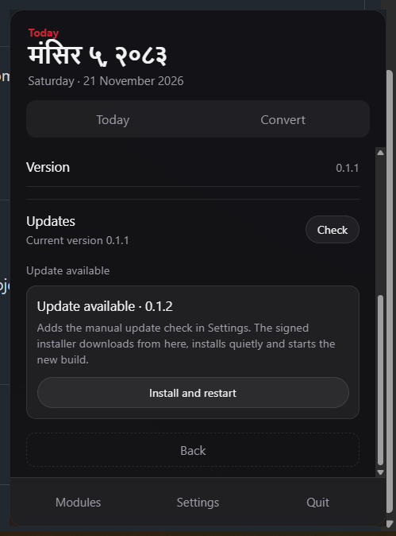

# NepaliToolkit 0.1.2 alpha

The first build that can update itself.



## What is new

- **Updates in Settings.** Press Check for updates. The app reads a signed release
  manifest, and if a newer alpha exists it shows the version and the release notes.
  Press Install and restart to install it.
- **Signed and quiet.** The installer is signed with the project's Tauri minisign
  key. The app verifies the signature, installs without an installer window, and
  starts the new version. The manifest is bound to the signed version, so a
  tampered manifest cannot pair a new version number with an old installer.
- **Manual only.** There is no background check and no automatic download. The app
  reaches the network only when you press the button.
- **Portable stays portable.** The portable build points you at the release page
  instead of replacing itself with the NSIS install.

The date engine, the tray badge, the converter and the rest of the interface are
unchanged from 0.1.0.

## If you have 0.1.0

The 0.1.0 alpha has no updater. Install 0.1.2 once; from then on Settings handles
new alphas. Your settings and autostart choice carry over.

## Download

- [Installer](https://github.com/NepaliTools/NepaliTools/releases/download/v0.1.2-alpha/NepaliToolkit-0.1.2-alpha-win64-setup.exe).
  Per-user, no administrator. Adds a Start Menu shortcut and an uninstaller.
- [Portable zip](https://github.com/NepaliTools/NepaliTools/releases/download/v0.1.2-alpha/NepaliToolkit-0.1.2-alpha-win64-portable.zip).
  Extract and run `NepaliToolkit.exe`.
- [SHA256SUMS](https://github.com/NepaliTools/NepaliTools/releases/download/v0.1.2-alpha/SHA256SUMS.txt).
- [latest.json](https://github.com/NepaliTools/NepaliTools/releases/download/v0.1.2-alpha/latest.json),
  the update manifest the app reads.

Both downloads need WebView2. Windows 11 includes it. The installer embeds the
WebView2 bootstrapper for older Windows 10 machines.

The build is unsigned, so Windows may show "Windows protected your PC". Choose
More info, then Run anyway.

## Checksums

The `SHA256SUMS.txt` asset covers the installer, the portable zip and the update
manifest. Verify on Windows with:

```powershell
Get-FileHash .\NepaliToolkit-0.1.2-alpha-win64-setup.exe -Algorithm SHA256
```

## Known limits

- The build is unsigned.
- The updater only replaces the installed copy. Portable users download the new
  zip and keep their own folder.
- Years after 2090 remain single-source projections.
- Windows only. macOS is the next milestone.
- The installer still closes after copying instead of showing a finish page; open
  NepaliToolkit from the Start Menu after installing.

## Privacy

The date data ships inside the binary. The only network request is the update
check you start, and it fetches only the manifest and, if you install, the signed
installer. No telemetry, no account, nothing about you is sent.

## License

MIT. See
[LICENSE](https://github.com/NepaliTools/NepaliTools/blob/main/LICENSE).
