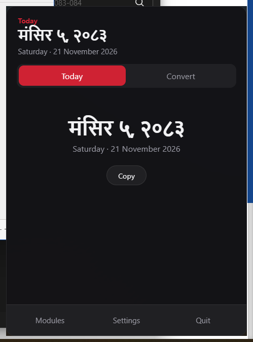

# NepaliToolkit Wiki

NepaliToolkit is a Windows tray app for Nepali dates. It shows today's Bikram
Sambat (BS) date in Devanagari and converts dates both ways between BS and AD.
The tray host is built to hold more Nepali tools.

## Pages

| Page | What it covers |
|---|---|
| [Installation](Installation) | Requirements, first run, tray pinning, autostart, uninstall |
| [Features](Features) | What every screen does |
| [Nepali date and Bikram Sambat](Nepali-Date-and-Bikram-Sambat) | The calendar, month names, supported years |
| [Data and accuracy](Data-and-Accuracy) | Sources, the majority rule, overrides, tests |
| [Building from source](Building-from-Source) | Toolchain, commands, test switches |
| [Troubleshooting](Troubleshooting) | Common problems and fixes |
| [FAQ](FAQ) | Short answers |
| [Roadmap](Roadmap) | What is next |

## At a glance

- The tray icon shows the BS day in Devanagari. Hover it for the full date.
- Left click the icon or press `Ctrl+Alt+N` to open the panel.
- English interface by default, Nepali one click away.
- The app is offline. It has no accounts, no telemetry and no update check.
